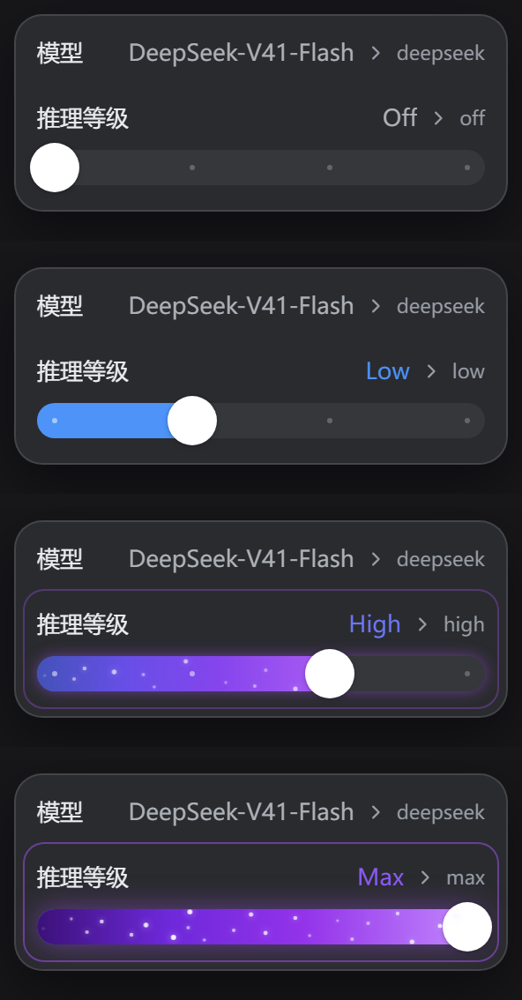
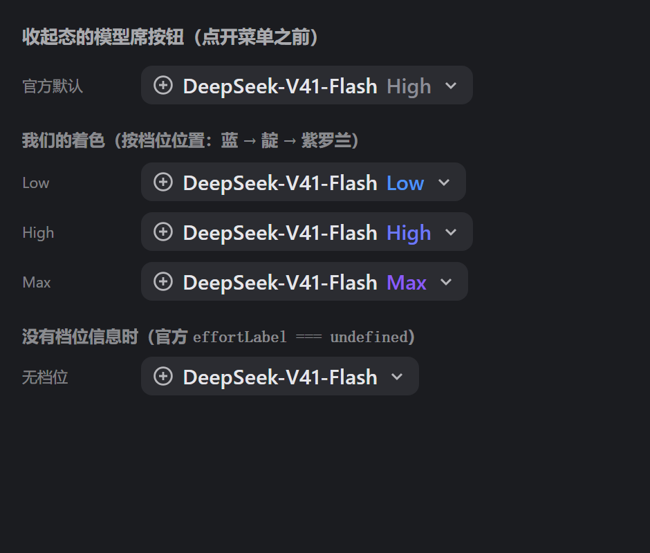
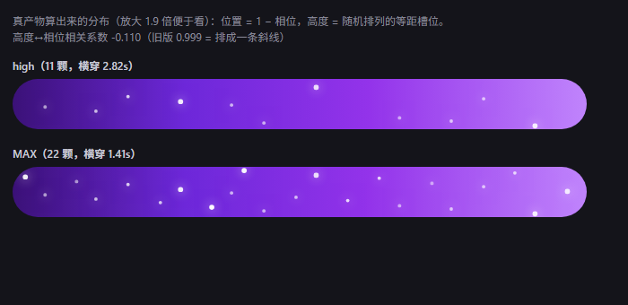

# better-dsh-codex-effort-slider

给 [DeepSeek Harness](https://github.com/deepseek-ai/deepseek-harness)（DSH）用的 **Codex 风格推理等级滑条**。

**一档一色、越往右越"通电"**：填充从蓝渐变到紫罗兰，高档位亮起紫色星云与星尘粒子，
连官方那一行的数值文字也跟着变色（`Off` 档保持官方灰）。



| 收起态的模型席按钮也跟着变色 | 星尘分布（真产物算出来的） |
|---|---|
|  |  |

浅色主题同样可读（对比度都算过：白底 4.23:1、深色底 4.02:1）：见 [`preview/value-color-light.png`](preview/value-color-light.png)。
**不用安装也能先玩**：浏览器打开 [`preview/panel.html`](preview/panel.html)，可拖动、切浅深色、切 4/2/6 档模型。

它现在有**两个界面**，都在插件里、都不动官方那颗模型席按钮。**但默认只启用 B**：

> **默认开关**：`lib/client.js` 里 `ENABLE_OFFICIAL_MENU_SLIDER = false`。
> 主入口是自建浮层（B），两套 UI 同时挂在同一个输入区里会互相干扰（官方那一行里会多出一条
> 滑条）。想回到"改造官方菜单"那条路，把它改成 `true` 即可 —— A 的组件、纯函数与第 2–26 节
> 断言全部照旧保留着。

**A. 官方菜单那一行（1.x 起，默认关闭）**：直接改造官方模型菜单里的「推理等级」那一行 ——
那一行被加高上下内距、允许折行，滑条作为第二行铺满整行宽度；拖到最高档时整条轨道亮起紫色能量层。
另外往官方菜单里加**三处只读注记**（都只 append，不改官方任何文字）：

```
点开官方模型菜单后：
┌──────────────────────────────────────────────┐
│ 模型             DeepSeek-V41-Flash › deepseek│  ← 归属标签（provider，一级页就能确认）
├──────────────────────────────────────────────┤
│ 推理等级                       Max ›  max    │  ← 数值文字跟着变色；右侧灰字是原始 API 取值
│ ●━━━━━━━━━━━━━━━━━━━━━━━━━━━━━━━━━━━━━━━━━    │  ← 插件注入的滑条（这一行因此被加高）
└──────────────────────────────────────────────┘

点「模型」进二级页（官方那一屏）：
  DeepSeek-V41-Flash  [4 档]
  gpt-6-astra         [8 档]
  gpt-6-luna          [7 档]
  gpt-6-spark         [5 档]
  gpt-4o              [不支持]
输入框工具行：**不加任何东西**（没有胶囊、没有浮层）
```

**B. 自建浮层（1.3.0 起，按 `code.html` 复刻；1.3.2 起**接管官方那颗模型席按钮**）**：
输入框右侧那颗 `模型名 · 档位名 ⌄` 就是它 —— **没有第二颗**（见下面"接管"一节），
点开是**两级面板**（挂在 `conversation.input.overlay`，所以不会被 composer 卡片裁掉）：

```
收起态：  [ DeepSeek-V41-Flash · Max ⌄ ]

点开后：
┌──────────────────────┐
│ 模型                  │
│ DeepSeek      V41-Flash ›│   ← 一级页：provider 行 + 该 provider 当前选中的模型名
│ OpenAI                ›│
├──────────────────────┤        点 provider → 同一块面板**横向翻页**到二级：
│ 推理等级          Max ⌄│      ┌──────────────────────┐
│ ●━━━━━━━━━━━━━━━━━━━ │      │ ‹ DeepSeek           │
└──────────────────────┘      │ [搜索模型…          ] │
                              │ DeepSeek-V41-Flash ✓ │
                              │ DeepSeek-V41-Pro  4 档│
                              │ Plain Model    不支持 │
                              └──────────────────────┘
点档位名展开弹层：每行 = 档位名 + 原始 API 取值
  Off   off
  Low   low
  High  high   ✓
  Max   max
```

两页是**同步位移**的（`page1 0 → -100%` / `page2 +100% → 0`），所以边界全程贴合；
点模型**不关面板**、滑条立刻跟到新模型的档位（这是"自建面板"相对内置注入的关键好处：
内置注入借官方菜单的 DOM，官方菜单一关就跟着没了）。

面板的位置口径（1.3.4 定稿）：**右缘贴 composer 卡片右缘**（就是输入框那条右边线）、
**底边贴触发器上方 8px**；**滚动/窗口缩放只重定位、不关闭** —— 助手流式输出时聊天区会一直
自动滚动，早先"滚动即关闭"会把面板关掉（用户实测："对话还没结束，对话一刷新，面板就没了"）。
触发器被宿主 `hidden`（助手在跑时 composer 会藏起控件行）时保持原位，既不乱飞也不消失。

### 那颗按钮：1.3.2 起是**接管**官方模型席，不是并排

1.3.0/1.3.1 的实现是"在工具行**新增**一颗"，于是输入区里并排两颗一模一样的
`模型名 · 档位名 ⌄`（官方那颗 + 我们那颗）。1.3.2 改成**接管官方那一格**：

- 官方那颗席按钮注册在槽位 `conversation.input.model`，那是一个 **single 槽**，
  官方注册时**没写 `priority`（= 0）**；
- 槽位内核（`@deepseek-ai/dsh-client-ui-slots`）对 single 槽的规则是
  "同 priority 撞了会抛错，**换个 priority 就遮蔽它 —— 最低者渲染**"，
  所以我们用 **`priority: -1`** 注册同一格，官方那颗**整个不渲染**；
- 这不是钻空子：官方槽位目录给这一格标的 `replaceRisk` 就是 `shadows-shipped-ui`。
  我们**没有**去动官方 DOM（没藏、没删、没改 class），账本里官方那条还在，只是不再被渲染。

随之必须接过来的两条 **owner 语义**（官方那颗原著有的）：

| owner 给的 | 官方那颗怎么用 | 我们怎么用 |
| --- | --- | --- |
| `locked`（owner prop） | `disabled` | 按钮 `disabled` + `data-locked` + `aria-disabled`，点不开面板 |
| `--dsh-composer-model-text-display` / `--dsh-composer-model-icon-display` | 窄行里切成纯图标 | 同一套变量：文字/图标互换，自绘了一颗"层叠"图标 |

**拿不到那一格就自动退回老位置**（`conversation.input.right`，与官方那颗并排）：
`inject` 是"等槽出现"而不是抛错，所以退路分三种时序处理 —— 官方席先出现就直接接管；
工具行先出现就先挂上、官方席随后出现时撤掉工具行那条再接管（两个回调同一批同步执行，
中间没有绘制，看不到闪动）；官方席始终没有、或注册抛错（比如哪天改成 list 槽、或有人
用同一个 priority 占了），工具行那条就是最终落点。**最差也只是回到"两颗按钮"，
绝不会两边都没有。**

**接管意味着那份"报告"也归我们了**（1.3.3 补上）：官方那颗席按钮原本还负责把
"目录正在加载 / 没有可用 provider / 某个 provider 加载失败（`{name} 加载失败：{message}`）"
显示在它自己的菜单里。接管之后自建面板就是唯一的窗口，所以这些状态现在都画在面板里，
而且高度算得下它们 —— 早期版本里那句提示会被 `.cxp-viewport` 的 `overflow:hidden`
**整句裁掉**，真机上表现成"面板一片空白 + 档位 `—` + 滑条灰掉"，连原因都读不到。
目录"没到"时按钮写"正在加载模型…"（对齐官方的 `trigger.loading`），不再和"目录空"共用"模型"两个字。
`load` 失败按 60ms→3s 退避重试、退避用尽由 1.5s 心跳兜底；**"就绪但空"**（宿主 provider
还没注册完时它会返回一个合法的空目录，而且会被缓存、光 `load()` 不会重新拉）则借官方 resolver 的
`catalog.refresh()` 主动刷一次 —— 8 秒冷却、最多 3 次，全程 fail-open。

**标着「不支持」的模型同样可以点**——选模型与配档位是解耦的：点它**只切模型**，滑条卡片转为
禁用态、档位名显示 `—`；那次写入**不带 `reasoningEffort`**（键整个不出现 = "对档位没有意见"，
不是显式清除；契约与官方产物一致，第 12 节有产物对照断言）。徽标文案与灰显样式都不变。
再切回有档位的模型，一切照旧。

**档位徽标读的是目录快照**（`groups[].models[].reasoning.efforts`），不是本地写死的清单；
目录没列到的已知家族才退到本地兜底，两边都不认识就**不写徽标**（不瞎标）。
另外，**禁用态是渲染函数的完整投影**：每帧从最新快照重算，不可能粘滞。

**二级页的模型列表按「新发布 → 旧发布」排**。宿主目录里**没有发布日期字段**
（`session/modelCatalog` 的产物 schema 只有 `{ id, name, description?, reasoning? }`，
逐字核对过），所以顺序只能从名字里已有的两个信号算：

| 信号 | 认什么 | 例子 |
| --- | --- | --- |
| 版本号 | 第一个数字串（**id 里没有就看显示名**） | `gpt-6-astra` → 6、`gpt-5.6-sol` → 5.6、`deepseek-v41-flash` → 41、`deepseek-flash` 的名字 `DeepSeek-V41-Flash` → 41 |
| 日期 | `2026-01-13` / `20260113` / `2026-01` | `gpt-4o-2024-05-13` |

规则（确定性、稳定排序）：版本号**降序** → 同版本**别名在前、它的快照版在后**
（`gpt-6-astra` 指最新，`gpt-6-astra-2026-01-13` 是钉住的旧版）→ 同为快照按日期**新 → 旧** →
认不出版本号的**沉底**且保持宿主原顺序。全部由一个纯函数 `sortModelsNewestFirst` 决定
（排序在 `readCatalog` 里做一次，所以搜索过滤结果跟着同一个顺序），第 41 节有 20 条断言盯着它。

拖到最高档：轨道变为**紫色星云**（流向渐变 + 扫光 + 22 颗错峰星尘粒子），那一行同时描一圈紫边。

**30 秒上手**：下载/克隆本仓库 → 双击 `install.cmd`（或按下面的「安装」一节）→
**完全退出并重开** DSH Desktop。

> [!IMPORTANT]
> **本仓库是上游 [dsh-codex-effort-slider](https://github.com/Microqian2th/dsh-codex-effort-slider) 的修改分支（当前 `1.3.10`）。**
> 相对上游的改动集中在几处：滑条观感对齐 GPT 客户端（球比轨道大、球是真圆、Max 档隐藏其他定位点）；
> 拖动改成一档一格 + 快慢两档动画（拖得慢，动画也慢）；写回宿主改成停顿去抖（修连续拖动发卡）；
> 1.2.0 从参考实现移植进来的三处注记 + 禁用态投影 + 翻页滚动稳定化；
> 1.3.0 再按 `code.html` 复刻了**自建浮层**（两级面板 + 档位徽标 + 常驻滑条 + 档位弹层），
> 它现在是默认入口（官方菜单那条路由 `ENABLE_OFFICIAL_MENU_SLIDER` 开关控制、默认关闭）。
> 另：本分支**去掉了滑条的键盘操作** —— 不接管方向键、不进 tab 序，官方菜单的键盘导航保持原样。
> 完整清单见 [MODIFICATIONS.md](MODIFICATIONS.md)（改了什么、为什么改、怎么验证、有哪些取舍，
> 以及**逐条**的移植对照：哪些原样落地、哪些等价替换、哪些在真宿主里不适用）。

## 安装

> 不想 clone 的话，直接下载本仓库 Releases 里打包好的 zip（文件名 `better-dsh-codex-effort-slider-<version>.zip`，
> 由仓库根目录的 `npm run pack` 生成）。

**只走 DSH Desktop 自己的插件面板**——命令行装不了 `desktop` profile：

```powershell
dsh plugin --profile desktop add link:"F:\Work Space\DeepSeek Harness\better-dsh-codex-effort-slider"
# error: profile "desktop" is managed exclusively by the Electron application
```

（这不是配置问题：`bin.js` 里对 `desktop` 直接 `program.error`，只有 Electron 应用本人被允许管理这个保留 profile。）

两条路：

1. **面板安装**（推荐）：**设置 → 插件 → 添加插件** → 填本地目录路径 → 安装 → 重启 DSH Desktop。
   面板会校验两件事，本插件都已满足：是有效的插件包、声明了组合包（`dsh.bundle.patch`）。
2. **手工安装**（当面板本身不可用时——例如 `profileContext` 没挂上，`dsh-base` 会把
   `plugin-manager` 整行 `disabled`，设置侧栏里就看不到「插件」）：
   备份 profile 的 `package.json` → 加一条 `link:` 依赖 → `dsh.profile.bundles` 追加本包名 →
   在 `profiles/<profile>/node_modules/` 下建一个指向本目录的 junction → 重启。

> 卸载用面板；手工装的用 `cmd /c rmdir <junction>`（**不要**用 `Remove-Item -Recurse`，
> 那可能顺着 junction 把插件目录里的文件删掉）。

想先看观感、不装也行：`node preview/make-preview.mjs` 生成 `preview/panel.html`，
用浏览器打开即可拖动、切浅深色、切 4/2/6 档模型（页面里连官方菜单外壳都复刻了，
CSS 与拖动数学都是从真产物抽出来的）。

## 分享给别人

### 打包

```powershell
npm run pack        # 运行时包：只有跑起来需要的 5 个文件
npm run pack:src    # 源码包：源码 + 构建脚本 + 离线断言 + 文档
```

两种包共用 `pack-dist.ps1` 的同一套 zip 写入与校验逻辑（`-Source` 切换清单）：

| 包 | 文件 | 内容 |
|---|---|---|
| `dist/better-dsh-codex-effort-slider-<version>.zip` | `package.json`、`cordis.patch.yml`、`lib/index.js`、`lib/client.js`、`lib/client.picker.js` | 装/升级用。零运行时依赖，解开就能装，接收方不需要 `pnpm install` |
| `dist/better-dsh-codex-effort-slider-<version>-src.zip` | 上面这些 + `lib/client.picker.src.js`、`build/pack-picker.mjs`、`test/`、`preview/`、文档与安装脚本 | 读源码 / 自己改 / 自己验证用 |

源码包是**自足**的（没有 `node_modules` 也能跑）：解开后 `node build/pack-picker.mjs` 可重现同一份
chunk（哈希不变），`node test/client.test.mjs` 直接跑 908 项离线断言。

本插件**零运行时依赖**。若要让人从 GitHub / npm 装，把**本目录的内容**推到仓库根
（`package.json` 必须在仓库根，pnpm 才能把它当包解析）。

### 接收方怎么装（三种，按省事程度排序）

1. **面板安装（推荐）**：DSH Desktop → **设置 → 插件 → 添加插件**，填三者之一：
   - **本地目录路径**（解开 zip 后那一层目录）
   - **`github:<用户名>/<仓库>`**（面板会先做一次 GitHub 连接检查，再交给 pnpm 拉取）
   - **npm 包名**（走 registry；DSH 默认已配 npm 镜像作为回退）
2. **命令行**（**只有非 desktop profile 能这么装**）：
   ```powershell
   dsh plugin --profile tui add link:"<插件的绝对路径>"
   dsh plugin --profile tui add github:<用户名>/<仓库>
   ```
   `desktop` 是 Electron 保留 profile，命令行会被直接拒绝
   （`error: profile "desktop" is managed exclusively by the Electron application`）。
3. **脚本**（desktop profile 且设置里没有「插件」面板时）：
   ```powershell
   install.cmd                    # 装进 desktop
   install.cmd -Profile tui       # 装进别的 profile
   install.cmd -Uninstall         # 卸载
   ```
   `install-profile.ps1` 做四件事：备份 profile 的 `package.json` → 加一条 `link:` 依赖 →
   把包名追加进 `dsh.profile.bundles` → 在 profile 的 `node_modules` 下建链接
   （Windows 用 junction，其它平台用符号链接），最后校验这三项都成立。
   **已用一个假 profile 完整跑过安装与卸载**，并确认卸载只删链接、不会顺着链接删掉插件本体。

### 注意事项

- `link:` 里是**绝对路径**，所以每台机器装完都必须指向自己的目录（面板/脚本会自动写对）。
- 改过 `lib/client.js` 后**必须完全退出并重开** DSH Desktop 才生效 —— 宿主在启动时把插件读进内存，
  只关窗口不够。
- **卸载**：面板卸载，或 `install.cmd -Uninstall`；手工建过 junction 的用 `cmd /c rmdir <junction>`。
  **不要**用 `Remove-Item -Recurse`，它可能顺着链接把插件目录里的文件删掉。
- **兼容性**：DOM 锚点全部是官方**语义属性**（`aria-haspopup` / `aria-expanded` / `aria-controls` / `role`）
  加两个官方 class；哈希前缀不依赖（收起态那段档位文字是**按文字**认的）。官方若改语义，插件
  **静默不生效**（fail-open），不会把官方界面改坏。本插件**不注册任何宿主钩子、不注入消息**
  （测试里有 `ctx.on` 监视断言守着这一点）。
- 许可 MIT（见 `LICENSE`）。`package.json` 里现在是 `"private": true`（**要发 npm 得先删掉这一行**）。

## 它怎么工作（两半）

| 半边 | 干什么 |
|---|---|
| `lib/index.js`（宿主） | 空逻辑 + 一次客户端产物静态核对（`lib/client.js` 与 `lib/client.picker.js` 分开报）。存在的唯一理由是让本包成为 cordis 树上的一行，否则 `dsh.client` 的 bundle 不会被扫进启动图 |
| `lib/client.js`（客户端·接线） | 不可见锚点（注册进 `conversation.input.right`，用来拿 `sessionId` 与 `ctx`）+ **DOM 桥** + 官方菜单那行的滑条（`react-dom` portal 注入官方那一行）+ 自建浮层的接线 |
| `lib/client.picker.js`（客户端·自建面板） | 按 `code.html` 复刻的自建浮层：收起态按钮 / 两级面板 / 模型档位徽标 / 常驻滑条 / 档位弹层。它是**包内动态 chunk**（宿主的 `client.*.js` 规则），由 `require.async("./client.picker.js")` 取；取不到时只有它消失，官方菜单那条路照常 |

### DOM 桥依赖的官方锚点（全部是**语义属性**，不是哈希 class）

| 锚点 | 官方产物里的形状 |
|---|---|
| 席：`button[aria-haspopup="menu"][aria-expanded="true"]` | `<button aria-haspopup="menu" aria-expanded={open} aria-controls={…}>` |
| 菜单：席的 `aria-controls` → `getElementById(…)` | 菜单 `id={…-menu}`，portal 到 body |
| 目标行：菜单里 `button[role="menuitem"]` 的**第 2 个** | 根面板恰好两行（模型 / 推理等级）；子面板用 `menuitemradio`，所以 `menuitem` 唯一标识根面板 |
| 模型行：`button[role="menuitemradio"][id$="-model-N"]` → `.optionCopy > .modelName` | 档位徽标按**行上的模型名**认（不用 id 里的序号：那是筛选后的位置） |
| 档位行：没有 id 的 `button[role="menuitemradio"]` | 原始 API 取值按文档顺序对上 `reasoning.efforts` |
| 根面板行：`.cellLabel` / `.cellValue` / `.cellChevron` | provider 归属标签追加在最后 |
| 滚动容器：`.scrollable`（字面量 class） | 翻页稳定化（`overflow-anchor:none` + 滚动清零） |
| 归属判定：从自己的锚点向上找 `[data-composer-card]` | composer 卡片带这个标记；打开的那颗席必须在**自己的** composer 里 |

**只改那一行**：写 4 个内联样式（`height:auto` / `flex-wrap:wrap` / `padding-block:10px`）+ append 一个容器；
关菜单或插件卸载时逐个还原。不碰官方 class、不改官方文字与 chevron。
**三处注记**（徽标 / 归属标签 / API 取值）同样只 append，不改官方任何文字，也不改它的 hover/focus 机制。

**fail-open**：任何一步认不出（没有 `aria-controls`、不是根面板、不是自己的 composer、
目录里没有档位、会话作用域没就绪）就**什么都不做** —— 官方菜单保持原样，绝不会因为本插件点不开。

官方菜单是"测量后固定定位"的，插件加高那一行后会派发一次 `resize`，
官方自己的 `place()` 会重新读 `offsetHeight` 并重新夹取位置。

## 数据路径（只用官方公开面）

| 用途 | 接口 |
|---|---|
| 读档位 | `directoryFor(sessionId).store.getSnapshot()` → `groups[].models[].reasoning.efforts` |
| 读**能力索引**（徽标用） | 同一份快照：`groups[].models[].reasoning`（缺席 = 该模型不支持推理等级） |
| 写档位 | `directory.select({ provider, model, reasoningEffort })`（与官方菜单同一写入口） |
| 订阅 | `store.subscribe()` + `React.useSyncExternalStore` |

**能力清单是活数据，不是本地快照**：徽标上那个"几档"直接来自 `reasoning.efforts` 的长度；
本地只留一张 9 键的档位字典（`LV`）用来**校验**未知档位 id 与补显示名，以及一张 GPT 家族的兜底清单
（只在目录没列到某个模型、或那一行认不出名字时才用）。参考实现那句
"能力清单是静态快照，生产应由宿主侧目录下发，客户端只做检测与渲染" —— 本插件就是按这句做的。

## 色彩与粒子（**由位置连续驱动**，与档位数无关）

拖到哪，颜色与粒子就跟到哪。三个纯函数（都有断言）：

| 位置 `pct` | 颜色 `fillColorFor` | 能量 `energyFor` | 粒子数 `particleCountFor` | 速率 `speedFor` |
|---|---|---|---|---|
| 0（第一档） | 蓝 `#4d93f8` | 0 | 0 | 0.35× |
| 1/3（第二档） | 蓝（**第一档到第二档恒为蓝**） | 0 | 0 | 0.35× |
| 2/3（high） | 紫 `#9333ea` | 0.5 | 11 / 22 | **1×（就是"现在这个速度刚刚好"）** |
| 1（max） | 深紫 `#4c1d95` | 1 | 22 / 22 | **2×** |

- **颜色**：填充层是 `linear-gradient(90deg, 蓝, 当前位置的颜色)` —— **左端恒为蓝、右端是当前位置的颜色**，
  所以 high 档自然呈现"左蓝右紫"，越往右右端越深（深紫 `#4c1d95`）。
- **能量层**（紫色星云 + 扫光）强度 = `energyFor`，它在第二档以前是 0 —— 所以左半段是**干净的蓝**，
  往右才逐渐"通电"；官方那一行的紫边透明度也跟着能量走（`0.16 + 0.34 × energy`）。
- **能量条只覆盖已填充那一段**：能量层宽度与填充层完全相同（都到旋钮圆心），
  所以**档位右边没达到的部分不会出现能量条**，只剩轨道底色。
- **Off 档在"两个界面"里都保持官方灰**（`isOffLevel` + `valueColorFor` 返回**空串**）：
  Off 档时既不给菜单里那一行的数值文字上色，也不给收起态席按钮上的档位文字上色 ——
  空串 = 不写内联色 = 官方原本的颜色。档位是不是"关"按 **id 和 name 都认**（`off`/`none`/`关闭`/`无`，
  大小写与空格不敏感；DeepSeek 的真实档位表见 `dsh-llm-deepseek/lib/index.js` 的 `REASONING_EFFORTS`）。
  Off 档本身也没有能量层（energy 0 → 纯蓝、无星云、无星尘）。
- **档位数变了也是一条连续曲线**（1.2.0 明确下来的口径）：能量只看**位置**，
  与"这是 4 档还是 8 档模型"无关。所以 8 档模型下 `Max`（位置 6/7）已经是中后段的 **11/14 ≈ 0.786**、
  `Ultra`（位置 1）满星云；而"半能量"这个锚点仍然是 **4 档模型的 high（位置 2/3）= 0.5**。
  （参考实现给 8 档走的是 `(n-2)/(n-1)` 回退，8 档下只有末档点亮、Max 是 0 —— 那是两套口径并存，
  本插件统一成一套；逐条对照见 [MODIFICATIONS.md](MODIFICATIONS.md) 第七节。）
- **刻度点更小更淡**（用户要求）：`5px → 3px`；已达刻度 `rgba(255,255,255,.92) → .5`，
  未达刻度 `color-mix(... 38% → 26%)`。改小改淡之后它们不再和星尘粒子抢眼。
- **星空（所有出现粒子的档位都用这一套，动画已统一）**：
  - **不消失**：外层是一条**整轨宽度**的轨道，自己在做 `translate3d(-100%)` 的连续横穿；
    残影只在 0%/6% 与 94%/100% 淡出淡入 —— 那两端在可视区外，所以看起来星星**从不消失**。
    （旧的"短掠过 + 原地淡出"那套逻辑与 CSS 已整体删除，有断言守着 `.ces-particle` / `ces-drift` 不再存在。）
  - **亮度随机、越亮越大**：每颗的亮度/大小系数由确定性伪随机给出，落在 **0.5 ~ 1** 之间
    （1 = 3px 与亮度 100%）；圆点用 `opacity:var(--ces-b)` + `transform:scale(var(--ces-b))`，
    所以"亮的那颗同时更大"。
  - **速度随位置变化（保留）**：横穿时长 = `STARFIELD_DURATION_MEAN × MAX_SPEED_FACTOR / speedFor(pct)`
    —— **MAX 档 1.5s、high 档 3s、第二档附近约 8.6s**（位置速率 2× / 1× / 0.35×）。
  - **星星单独一层，不跟星云淡入**：星云层（紫色渐变 + 扫光）的透明度 = 能量强度，high 档只有 0.5；
    若星星套在里面，每颗的实际不透明度会被压到 0.25~0.5，在紫色底上几乎看不见
    （用户实测反馈"high 档一打开几乎没粒子"）。所以星星放在 `.ces-stars` 独立层，
    透明度 = `starLayerOpacityFor`（high 档 **0.8**、MAX 档 **1.0**），"逐渐出现"交给**粒子数**表达。
    **MAX 档观感与之前完全一致（都是 1.0），没有动。**
  - **各星之间只差 ±8%**（`STARFIELD_DURATION_SPREAD`）：保留"有的稍快有的稍慢"的层次，
    又不会像原来 0.95–2.05s（速度差 **2.16×**）那样快星追上慢星排成一队。
  - **高度 = 随机排列的等距槽位，并与相位解耦**（8%~92% 用满轨道高度）：
    早期版本高度和相位**取自同一个数** `frac((i+1)×φ)`，于是"越靠右的星越高"，22 颗排成
    一条斜线（用户实测反馈"太规整，再随机一点"；高度↔相位相关系数实测 **0.999**）。
    现在高度是一条**确定性随机排列**（哈希排序，不用 `Math.random`），并自动挑一个盐值
    保证**相位相邻**（会一直并排在轨道上走）的两颗至少差 **28%** 轨道高，不会并成一坨。
    相关系数实测 **−0.110**（有断言守着 `|r| < 0.35` —— 旧版会直接失败）。
  - **相位只跟 index 有关、跟"当前显示几颗"无关**（黄金比低差异序列，任意前缀都铺得开）：
    拖动改变粒子密度时不会改写已挂载动画的 `animation-delay`，所以**进档那一下不会被整体重排**。
  - **时长与相位直接内联**写在元素上（`animationDuration` / `animationDelay`），
    **不走 CSS 变量**：真引擎实测（无头 Chromium 逐帧读 `getComputedStyle`）两种写法相位都成立，
    但内联更少一层不确定性，"减少动态效果"的放缓也顺势改到 JS 里算（`REDUCED_MOTION_SLOWDOWN`）。
  - 伪随机是**确定性**的（`starHash01`，不用 `Math.random`）：重渲染不跳变，且可离线断言。

**"聚集"的量化对照**（模拟真产物参数，轨道 300×28px，两星中心距离 <6px 记为粘住）：

| t=0.2s（刚进档） | t=0.4s | t=1s | t=2s | t=3s |
|---|---|---|---|---|
| 3 对 → **0 对** | 1 对 → **0 对** | 4 对 → 2 对 | 7 对 → 4 对 | 4 对 → **0 对** |

**长期行为（如实标注）**：只要每颗星的时长不完全相同，相位就会**缓慢互相错开**，最终趋近随机分布
（22 颗里总会有几对偶尔靠近）。实测粘住对数随每颗星时长浮动变化：

| 每颗星时长浮动 | t=0.5s | t=1s | t=2s | t=5s |
|---|---|---|---|---|
| **±8%（当前）** | 1 | 7 | 9 | 17 |
| ±4% | 0 | 2 | 7 | 10 |
| ±2% | 0 | 0 | 2 | 11 |
| **0%（全同速）** | **0** | **0** | **0** | **0** |

也就是说：**想彻底永不聚集，就把 `STARFIELD_DURATION_SPREAD` 设成 0**（代价是所有星速度完全一致，
少了"有的快有的慢"的层次）；保留 ±8% 则偶尔会有几颗靠近一下再分开。这个数字由常量控制，随时可调。
- **官方那一行的数值文字（"Max" / "High"）也会跟着变色**（`valueColorFor`）：
  与能量同源，**蓝 → 靛 → 紫罗兰**，越往右越"通电"。写的是内联 `color`（内联优先于官方样式表），
  关菜单时由桥还原；**文字内容一个字都不碰**（断言：内容仍归官方管，标签与"模型"那一行完全不动）。
  终点色 `COLOR_TEXT_VIOLET = #8b5cf6` 是**照着对比度挑的**：白底 **4.23:1**、深色底(#1b1c20) **4.02:1**，
  两种主题都读得清（先试过更亮的 `#c084fc`，浅色主题只有 2.6:1 发虚；测试里有对比度断言挡着）。
  **Off 档例外：不上色，保持官方灰**（见上）。
- **收起态的模型席按钮**（`DeepSeek-V41-Flash  High  ⌄`，**点开菜单之前**就看得见那个档位）同样着色：
  官方那一小段文字是 `triggerEffort` 这个**哈希 class**（前缀随构建变，靠 class 认迟早失效），
  所以按**文字**认 —— 官方 trigger 里的文字就是档位的 `name`，和我们从目录读到的是同一份数据
  （已对照官方源码 `dsh-client-ui-model-selection/lib/client.js:860-867` 确认那是个 `<span>`）。
  传的是**全部档位名**而不是"当前那个"：档位刚切换、官方还没重渲染席按钮时文字还是旧的，
  只认当前名字会在那一瞬间掉色。
  - 席上显示的是**已生效**档位，所以拖动过程中它不跟着草稿跳，提交后才变（有断言）。
  - 官方重渲染换了节点 → 桥在重新抓到的那一刻立刻补色（不必等 React 再渲染一次）。
  - 组件卸载时还原；认不出任何已知档位名就**什么都不做**（fail-open：绝不动模型名等别的文字）。
- **`prefers-reduced-motion`**：**放缓而不是冻住** —— 收起扫光、粒子周期 ×2.6，并在滑条的 `title`
  里说明原因（冻成静态图会让"能量在流动"这个表达整个消失）。
- **配色跟随主题**：轨道底色用 `--dsw-alias-border-l1`；浅色/深色都自动跟随。

## 旋钮几何（顶头适配）

旋钮是**正圆，直径 = 轨道高度**（`TRACK_HEIGHT = KNOB_SIZE = 28px`），
圆心只在 `[14px, 宽度 − 14px]` 之间移动：

```
left = calc(14px + pct × (100% − 28px))     ← 旋钮、填充终点、刻度共用这一个几何
```

所以 `pct=0` 时圆心落在左端圆角内、`pct=1` 时落在右端圆角内，圆**永远是完整的圆**
（之前圆心跑到两端之外，圆被官方菜单的 `overflow:hidden` 切掉右半边，
看起来就像个圆角方块 —— 这也是把直径加大到与轨道同高的原因）。
指针映射也用同一套内缩几何（`pctAt`），所以拖到最左/最右必定命中端点档位。

## 稳健性（每条都有断言）

- `directoryFor()` 在会话作用域就绪前**按设计抛错** → 退避重试（60ms 起，约 9 秒）+ 自愈；
  档位数是**后到**的，桥会在档位数变化时主动重扫（DOM 不会因为 store 变化而产生 mutation）。
- 写入失败 / 超时（10s）→ 回滚到真实档位并显示原因，**不谎报成功**。
- 拖动写入有**同档位去重 + 在途合并 + 260ms 停顿去抖**：连续拖动期间 **0 次**写回，
  指针停住或松手才落地；落在当前档位时也是 0 次。
- 滑条吞掉自己的 pointer/click 事件（**不接管方向键**），**不会误触官方那一行的 onClick**（那会跳进等级列表）。
- 组件卸载时清掉去抖定时器；桥卸载时还原那一行的样式并摘掉容器。
- **禁用态每帧重算**（不做增量 patch）：目录这一代给不出可读档位时，滑条灰掉且不吃指针，
  并把 `aria-disabled` 同步进无障碍树 —— 不会出现"看着能用、拖了没反应"。
- **翻页那一帧把滚动位置清回 0**：官方换内容时的 `.focus()` 不带 `preventScroll`，加上我们给
  那一行加高触发的 scroll anchoring，本来会多出一次位移（看起来就是动画被吃掉）。
  菜单根与官方的 `.scrollable` 都关掉 `overflow-anchor`，清除动作在 mutation 回调里同步做（早于绘制）。

## 开发

`lib/client.js` 是**手写的发布产物**（`require("react")` 与 `require("react-dom")` 走宿主模块表的平台种子词）。
自建浮层那一个文件有**一步构建**：源码是 `lib/client.picker.src.js`，`npm run build` 把它包成
**自注册的包内 chunk** `lib/client.picker.js`（宿主的模块表要求 chunk 自己调
`window.__ModuleLoader__.load({ id, chunk, factory })`，而宿主 serve 时**不会**替它包壳）。
`npm test` 与 `npm run pack` 都会自动先跑这一步（`pretest` / `prepack`）。

```powershell
npm run build     # lib/client.picker.src.js → lib/client.picker.js（幂等；生成物别手改）
npm test          # 离线断言套件（908 项：几何/色彩/星空/注入/失败回滚/无注入回归/档位字典与徽标/翻页稳定化/自建浮层/chunk 契约/预览页自洽/模型列表排序/接管官方模型席）
npm run preview   # 生成 preview/panel.html
```

> **改了 picker 之后为什么页面没变**（宿主缓存键的坑，日常开发必踩）：chunk 的 URL 是
> `/plugins/<包名>/client.picker.js?rev=<rev>`，而这个 `rev` 是宿主按**`lib/client.js` 的
> mtime / ctime / size** 算出来的（`artifactRevision`），响应头还带
> `Cache-Control: public, max-age=31536000, immutable`。于是**只改 picker 不会让 rev 变**，
> 浏览器会拿一年缓存的旧 chunk，控制台安安静静、面板却是老的。
> 两种解法：**Ctrl+Shift+R 硬刷新**（或完全重启 DSH Desktop），
> 或者让 client.js 的时间戳动一下：
>
> ```powershell
> (Get-Item lib/client.js).LastWriteTime = Get-Date   # rev 变了 → chunk URL 跟着变
> ```

> **为什么 chunk 必须自己注册**（真机踩过一次，值得留个记录）：客户端模块表
> （`@deepseek-ai/dsh-client-modules`）是**按包名**建表的，同步 `require("包名/子路径")` 会抛
> "missed the module table"；包内 chunk 要用 `require.async("./client.picker.js")` 取，
> 且文件名必须匹配 `client.*.js`。宿主对 chunk 的响应体只做拼接、**不包壳**，
> 所以裸 ESM 的 `export` 会在脚本标签里直接语法错 —— 表现就是"入口按钮根本不出现、控制台很安静"。
> 第 32 节断言专门按真宿主的方式加载这个文件，防止再退回去；
> 第 34 节则盯着**样式真的进了文档** —— 同一版还踩过第二个静默失败：`installStyles()` 当时不收参数，
> 传给它的浮层样式表被静静丢掉，表现是「入口在、面板却完全没有样式、内容摊进页面流」。

测试台 `test/harness.mjs` 里有一份**保状态**的 React 桩、够用的假 DOM（含 portal、MutationObserver、
多属性/class/子串选择器、滚动位置、focus 记录）、以及一个**假官方菜单**（形状逐字对齐官方产物，
含模型列表与档位列表两个二级页）。本机没有可离线使用的真 React
（`app.asar` 里不带），所以渲染层是桩件驱动的；数据路径与 DOM 注入路径跑的都是真代码。

第 12 节断言会**直接读解包出来的官方产物**校验那些语义锚点还在（`aria-haspopup` / `aria-expanded` /
`aria-controls` / `role="menuitem"` / `role="menuitemradio"` + 官方文案 + `resize` 重测），
官方改版导致锚点漂移时会先炸测试，而不是静默失效。本机没有解包产物时该节自动跳过。

## 已知限制

- 需要重启 DSH Desktop 才生效（客户端 bundle 在启动时注入）。
- **官方菜单没有入口了**（1.3.2 起）：那颗模型席按钮就是官方菜单（模型列表 / 档位列表 /
  键盘导航 / aria）的唯一入口，被我们接管之后就打不开了。模型切换仍在两条路上：
  本插件的面板，以及 **`/model` 命令**（那是官方另一套 `popupSelect` UI，不受影响）。
  想回退成"官方菜单 + 里面长滑条"，把 `ENABLE_OFFICIAL_MENU_SLIDER` 改成 `true` 即可
  （那条路会给官方那一行注入滑条，同时关掉自建面板的接管）。
- 控制项活在官方菜单里，所以**必须先点开模型菜单**才能改档位；输入框工具行上没有常驻读数。
- 依赖官方菜单的 DOM 语义属性。官方若改成非 `menuitem` 结构、去掉 `aria-controls`、
  或不再用 `data-composer-card`，本插件会**静默退回"什么都不做"**（官方菜单照常可用）。
- **三处注记依赖"模型行有 id、档位行没有 id"**：官方若给档位行也编上 `model-` 样式的 id，
  徽标会停止工作（fail-open：只是不再写徽标，滑条照常）。
- **徽标的"几档"来自目录**：目录这一代还没列到某个模型、而它又不在本地兜底清单里时，
  那一行不会显示徽标（宁可不显示，也不瞎标）。
- **模型列表的"新 → 旧"是启发式的**：宿主目录不带发布日期，顺序由 id / 显示名里的版本号与
  日期算出（规则见上文）。名字里完全看不出新旧的模型一律沉底并保持宿主原顺序 ——
  比如 `o3-mini` 这类前缀不是版本号的家族，只能排在 `gpt-4o` 之后。
- **只排自建面板那一屏**：官方菜单里的模型列表由官方组件渲染，插件只往上加徽标，
  不去动它的顺序（改它的 DOM 会和官方 React 的重渲染打架）。
- **8 档模型只有末档满能量**这条观感与参考实现不同（本插件是连续曲线：8 档 Max = 11/14）——
  见 [MODIFICATIONS.md](MODIFICATIONS.md) 第七节第 4 条，是有意取舍。
- 那一行加高约 20px + 滑条 28px，菜单总高会变大；官方会自己重测位置，但极小屏幕上可能出现
  菜单贴边（官方自身的 `max-height` 与夹取逻辑仍在）。
- 主题令牌缺失时回退到中性灰 + `#4d93f8` 蓝，观感可用但不如在 DSH 内贴合。

## 许可

MIT。无第三方代码：闪电标/雪弗龙是自己画的路径，粒子层是自己写的 DOM/CSS。
